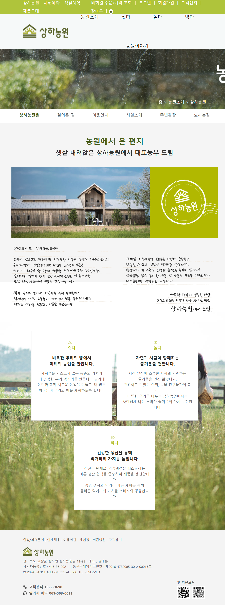
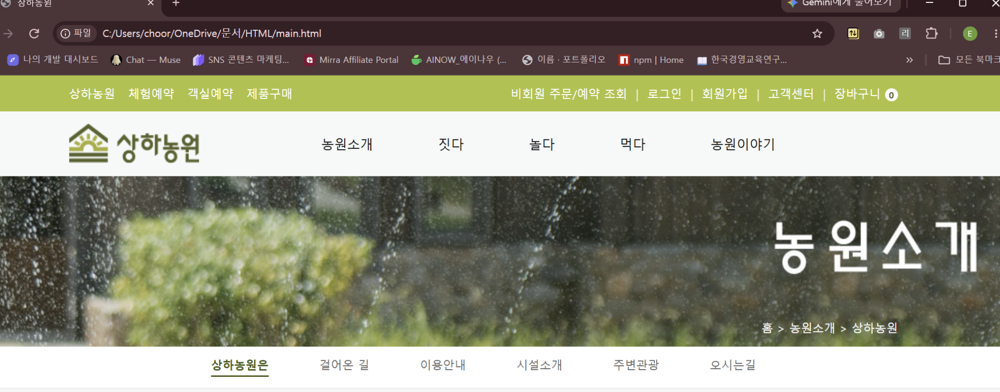
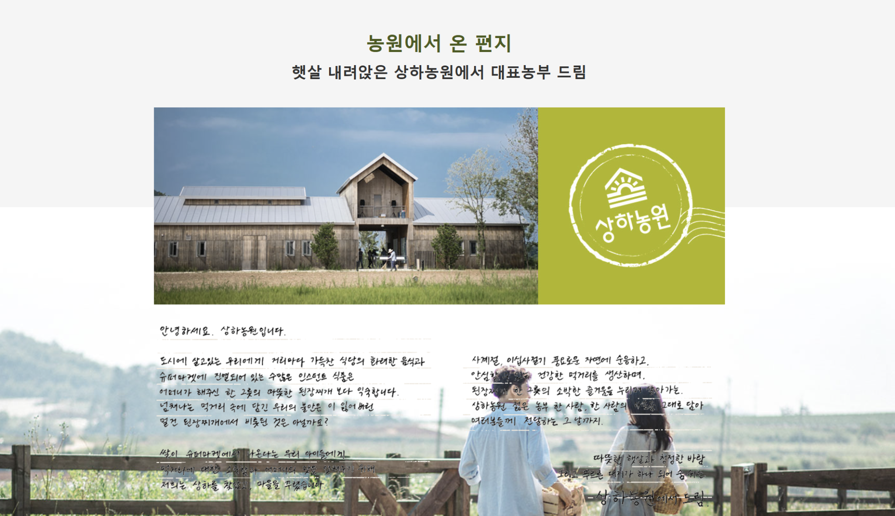
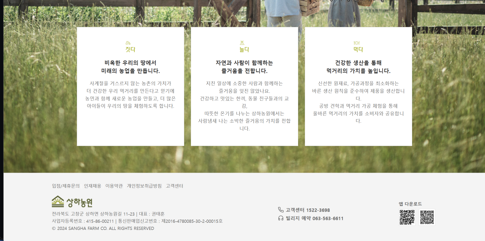

안녕하세요. 1조에서 상하농원 소개 페이지를 맡은 최지훈입니다!

일단 소개 페이지부터 간단히 설명드리면, 각 메뉴에 `<a href="#">`를 사용해서 링크 자리를 만들어놨습니다.

저를 시작으로 각 조원들의 세부 페이지까지 자연스럽게 연결하기 위해서 지금은 `#`으로 임시 지정해 놓았고, 나중에 주소만 넣으면 연결할 수 있도록 통로를 확보해 놨습니다.

이제 메인 소개를 보시면, 맨 위쪽 부분을 탑 배너로 지정하고 간단하게 스타일을 적용했습니다.

배운 대로 맑은 고딕을 사용했고, 맑은 고딕을 찾지 못할 경우에는 `sans-serif`로 글씨체를 유지하도록 했습니다.

탑 배너 부분은 `display: flex`를 사용해서 기본적으로 가로 정렬을 했습니다. 그리고 `justify-content: space-between`으로 메뉴를 양쪽에 배치하고, `align-items: center`를 이용해서 세로 가운데에 맞췄습니다.

메뉴 사이의 간격은 `gap`을 이용해서 벌렸습니다.

각 클래스의 스타일은 `style.css`로 빼서 불러올 수 있게 만들어놨습니다.

솔직히 작업하면서 약간 노가다 느낌이 많이 들었습니다. 물론 구조를 파악하고 있어야 해서 하나하나 보면서 하긴 했지만, 정확하게 모든 코드를 다 기억하지 못한다는 점은 조금 아쉬웠습니다.

이제 밑으로 잠깐 내려가 보시면 첫 번째 큰 사진이 나옵니다.

사진은 `images` 폴더에 따로 넣어놓고 CSS의 `background-image`로 불러왔습니다. 처음에는 `img` 태그로 연결하려고 했는데, 이미지 위에 글자와 어두운 효과를 따로 올려야 해서 찾아보니 `background-image: url()`로 연결하는 것이 더 낫다고 판단했습니다.

그 밑을 보시면 큰 영역 안에 각각의 박스가 세 개 들어가 있는 것을 보실 수 있습니다. 이 구역이 소개 페이지의 핵심입니다.

흔하게 사용하는 방식대로 큰 부모 상자를 먼저 만들고, 그 안에서 같은 틀을 찍어내듯이 `keyword-box`로 구분했습니다. 세 박스는 같은 구성을 사용하고 내용만 바꿔서 만들었습니다.

마지막은 어제 튜터님께서 설명해 주신 `footer-content` 영역입니다.

지금 F12를 눌러서 보시면, 한 구역 안에 서로 다른 세 개의 영역이 들어가 있습니다.

이 영역들을 `space-between`으로 가로 방향에 나누어 배치했고, `align-items: center`를 사용해서 세로 위치를 가운데로 맞춰 최대한 보기 좋게 정렬했습니다.

제 페이지는 이 정도로 구성되어 있습니다.

여기서 기억할 것은 먼저 `background-image`로 배경을 깔고 그 위에 글자나 다른 요소를 추가해서 사용할 수 있다는 점입니다.

반대로 배경이 아니라 사진 자체를 보여주기 위한 경우에는 `images` 폴더에서 `img` 태그로 불러올 수 있습니다.

마지막으로 `display: flex`를 사용하면 요소를 가로로 배치할 수 있고, `justify-content: space-between`으로 가로 공간을 나눌 수 있습니다. 그리고 `align-items: center`를 이용해서 세로 위치를 가운데로 정렬할 수 있습니다.

이 정도가 이번 소개 페이지의 핵심이 될 것 같습니다.

감사합니다!

안녕하세요 1조에 상하농원 소개페이지를 맡은 최지훈입니다!
일단 소개페이지로부터 간단히 설명드리면
 링크로 <a href="#" > 으로 각각 메뉴들을 들어갈수있게 구비를 해놨습니다
저를 시작으로 각 조원들의 세부페이지까지의 연결이 자연스럽게 하기위해 저는 #으로 임의 지정하여 언제든 연결통로만 확보를 해놨습니다
이제 메인 소개를 보시면
맨위에 부분을 탑배너로 지정하여 , 간단하게 style을 정하였습니다 배운대로 맑은고딕과 이를 찾지못할시 sans-self로 글씨체를 유지하려고 노력했습니다
탑배너 부분은 class 로 display:flex; 를사용 하여 기본 가로정렬 시작,  justifi-content : space-between 으로 양쪽정렬에  align-items = center를 이용하여 메뉴 구성을 보시면 전체적으로 하였습니다
가운데 빈부분은 gap을 이용하여 사이간격을 벌렸습니다
각 class 들은 style.css 로 이동하여 불러올수있게 만들어놨고
솔직히 약간 노가다 느낌이 많이 들었습니다. 물론 알고있고 구조를 파악하고있어야 해서 하나하나 보면서 하긴했지만 정확하게 다 기억나진않는게 좀 단점입니다.
이제 밑에 잠깐보시면 첫 사진이 나옵니다 사진은 images 폴더로 뺴놓고 백그라운드 이미지로 빼왓습니다 기존 이미지연결 로 할려고했는데 위에 글자가 따로 또 덮어씌워져야되서 찾아보니 백그라운드 url로 연결하는게 낫다고 판단했습니다
밑에보시면 큰 지역안에 각각 박스가 3개가 들어가있는걸 보실수있습니다 이구역이 핵심인데
흔하게쓰는 큰 부모상자를 만들어서 각각 틀안에 찍어내듯이 keyword-box 로 구분하여 같은 구성으로 내용만 바꿔서 구성하게 해놨습니다.
마지막으로 어제 튜터님이 설명해주신 footer-content 안의 영역입니다 지금 f12 를 눌러 여기 보시면, 한구역안에 3개의 각각 다른놈들이 들어가있습니다
이 각각의 구역들을, space-between으로 3등분시키고, align-items 로 세로 정렬 시켜서 모양을 최대한 이쁘게 보정하였습니다
제 페이지는 이정도로 구성이 되있으며 기억할거는 백그라운드 이미지로배경을 깔고 그위에 다른것들을 추가하여 사용가능한것 , 사진위에 따로 무언가 올라가면안될시에는 images 로불러와 고정할것
마지막으로 display flex와 justify-content space-between 으로 구역을 나눠 가로 정렬 시키고 align items 로 세로구역을 나눈다. 정도가 핵심이 될거같습니다
감사합니다

## 구현 화면

### 전체 화면

### 헤더

### 본문

### 푸터

