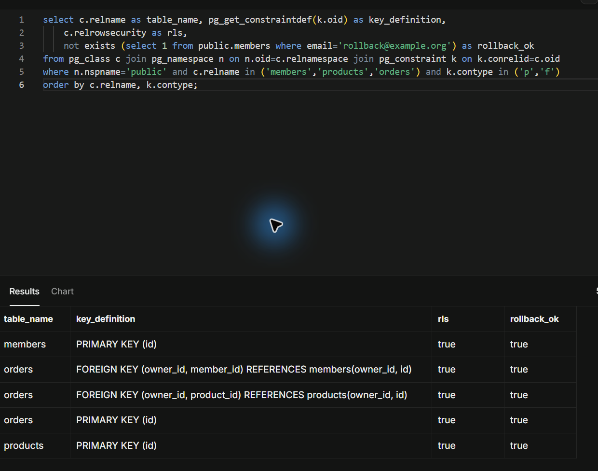
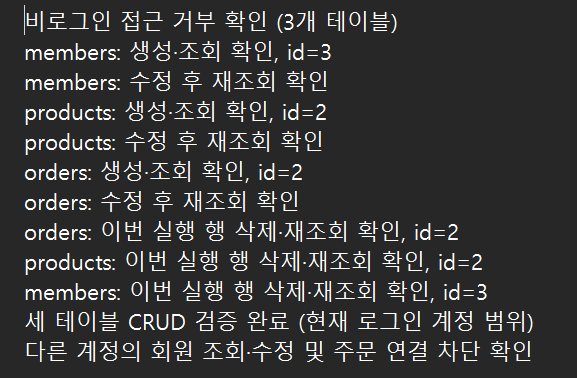

# CH2 데이터베이스·SDK CRUD 실습

## 목적과 현재 범위
Python에서 Supabase SDK로 회원·상품·주문을 생성, 조회, 수정, 삭제합니다.
수업에서 문서에 적용한 생성·조회·수정·삭제를 회원, 상품, 주문에 적용했습니다.
테스트용 데이터만 사용하며 기존 학습 행은 변경하지 않습니다.

## 파일과 테이블
- src/supabase_app/__init__.py: 설정 읽기, 시험 계정 로그인, 실행 진입점.
- src/supabase_app/crud.py: 세 테이블 CRUD와 실행 행 정리.
- members: id, name, email.
- products: id, name, price.
- orders: id, member_id, product_id, quantity.
- id는 행을 구별하는 기본키(PK), 주문의 두 참조 ID는 외래키(FK)입니다.
- sql/01_schema.sql은 테이블을 만들고, sql/02_access.sql은 owner_id와 접근 규칙을 추가합니다.
  일반 쇼핑몰 상품 공개 정책이 아니라 학습 계정별 데이터 격리 목적입니다.

## 실행
기존 잠금 파일과 가상환경을 사용합니다. .env에는 SUPABASE_URL과 공개 SUPABASE_KEY만 둡니다.
예시 시험 계정은 test@example.org입니다. SUPABASE_TEST_EMAIL / SUPABASE_TEST_PASSWORD는 실행 프로세스 환경변수로 전달합니다.
비밀번호·토큰·관리자 키는 README, 로그, 캡처, Git에 넣지 않습니다.

```powershell
uv run --locked python main.py
uv run --locked python main.py --run-crud
```

첫 명령은 설정 객체 구성만 하며 DB 접속 성공이 아닙니다.
두 번째 명령은 실제 로그인과 DB 쓰기를 수행하므로 승인된 시험 환경에서만 실행합니다.
기본값으로 실제 CRUD가 실행되지는 않습니다.

## 수업 API 흐름
1. table("members").insert({...}).execute(): 회원 생성 후 DB가 반환한 실제 ID 사용.
2. select("*").eq("id", 실제ID).execute(): 조건에 맞는 행만 조회.
3. update({...}).eq("id", 실제ID).execute(): 해당 행 수정 후 다시 조회해 값 비교.
4. delete().eq("id", 실제ID).execute(): 이번 실행이 생성한 행만 삭제하고 다시 조회.
5. 주문은 반환된 회원·상품 ID를 참조합니다. 정리는 주문 → 상품 → 회원 순서입니다.

owner_id는 클라이언트가 임의 지정하지 않고 로그인 사용자를 DB 기본값으로 기록합니다.
공개 키만 있어도 로그인 세션과 RLS 정책이 맞아야 CRUD가 허용됩니다.
한 계정의 성공만으로 다른 사용자 차단까지 검증됐다고 할 수 없습니다.
이 SDK의 여러 호출은 하나의 트랜잭션이 아닙니다. COMMIT/ROLLBACK은 별도 실습입니다.

## 실패와 정리
중간 실패에도 반환받아 기록한 ID만 정리합니다. 정리 실패 ID는 출력해 수동 점검합니다.
네트워크 단절로 INSERT가 서버에서 처리됐지만 응답을 못 받은 경우 ID를 모를 수 있습니다.
이때 기존 데이터를 추정 삭제하지 않습니다. 시험 계정과 고유한 test+ 표시로 별도 점검합니다.
강제 종료·네트워크 실패에서 완전 정리를 보장하지 않습니다.

## 제출 증빙
- 테이블 구조, PK/FK, 제약조건 캡처.
- 회원·상품·주문의 CRUD 전후 화면 또는 실제 실행 결과 캡처.
- RLS 정책 및 다른 계정 접근 차단은 별도 확인 기록.
- 실행 로그에 비밀 값이 없는지 검사 후 개인 GitHub README에 증빙 첨부.
### DB 구조 검증 화면



기본키 3개, 외래키 2개와 RLS 활성화 및 롤백 결과를 확인했습니다.

### CRUD 실행 결과



세 테이블에서 생성·조회·수정·삭제 후 다시 조회해 변경과 삭제를 확인했습니다.

공식 SDK 참고: https://supabase.com/docs/reference/python/insert

## 검증 결과 (2026-11-14)
- 실제 Supabase에서 회원·상품·주문 생성, 조회, 수정 및 삭제 후 재조회까지 확인.
- 비로그인으로 세 테이블 조회 시 모두 거부됨.
- 두 시험 계정 사이에서 회원 조회·수정이 차단되고, 다른 계정 회원으로 주문 연결 시 외래키로 거부됨.
- Supabase SQL Editor에서 기본키 3개와 외래키 2개를 확인. 임시 회원을 넣고 ROLLBACK한 뒤 조회 결과에 남지 않음.
- [실제 실행 로그](docs/verification.txt)

읽은 수업: [SDK 연결](https://app.notion.com/p/3d6578ecea318036bd51ccaa8e3cd88f), [생성](https://app.notion.com/p/3d6578ecea318000bc7bc5e1ce85bd80), [조회](https://app.notion.com/p/3d6578ecea318040a5f1f2e108e3e500), [수정·삭제](https://app.notion.com/p/3d6578ecea31806ca9dceed8b8e7447e).